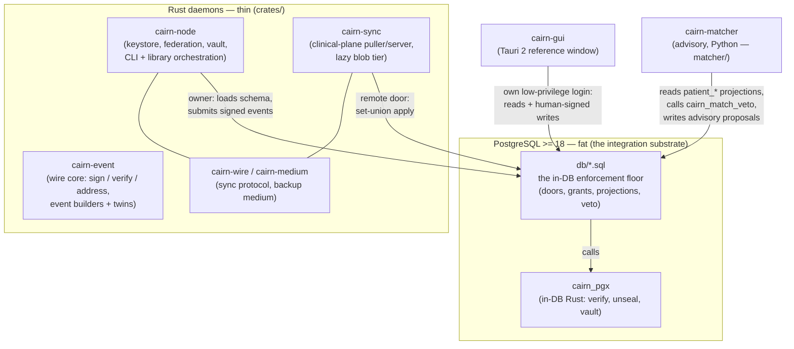

# Architecture for developers

This page gives you the **mental model** you need before the code reads as anything but a pile of
files. It is a developer-oriented summary, not the authority — the authority is the
[architecture spec](../spec/index.md) (one file per aspect) and the [ADR log](../spec/decisions/README.md)
(the *why*, immutable). Read this, then dive into the [Codebase tour](codebase-tour.md).

---

## 1. The one idea everything hangs from: an append-only, signed event log

Cairn does **not** store clinical data as rows you `UPDATE` and `DELETE`. It stores an **append-only
stream of immutable, signed events**. A correction is a *new* event that references the original; an
identity error is repaired by a *new* link/unlink event. Nothing is ever erased or mutated in place.

Why this matters to you as a developer:

- **Sync becomes safe.** Because events are immutable and content-addressed, synchronizing two nodes
  is a **set union** plus a small, explicitly enumerated set of clinically-reasoned merge policies —
  never a dangerous field-level merge. (This is principle 1; see the
  [sync spec](../spec/sync.md).)
- **The "current state" you query is a projection.** Tables like `patient_identifier`,
  `patient_name`, `medication_*` or `clinical_note` are *derived* from the event log by registered
  appliers. They are caches of the log, rebuildable from it (`cairn-node reproject`). You never write
  them directly — you submit an event and the projection updates.
- **Ordering is by Hybrid Logical Clock (HLC), not wall-clock.** Events carry an HLC so causal order
  survives clock skew across offline nodes. See the [Glossary](glossary.md#hlc-hybrid-logical-clock).

The four governing principles below are the lens **every** change is checked against. Internalize the
first four before writing code — the full set is in [spec/index.md](../spec/index.md).

1. **Append-only + causal ordering** — immutable signed events, HLC-ordered; corrections overlay.
2. **Identity is a claim, never a fact** — *never merge, always link; never erase, always overlay.*
   Patient UUIDs are immortal.
3. **Paper-parity (governing law)** — no workflow may be slower/harder/impossible than its paper
   equivalent. **Confirmation dialogs are explicitly not an acceptable safety mechanism.**
4. **Acknowledged uncertainty** — *unknown*, *not-yet-asked*, *refused*, ranges, and imprecision are
   first-class values. No required field may be satisfiable only by fabrication.

---

## 2. Fat Postgres, thin daemon

The safety-critical logic does **not** live in application code where many clients could each get it
subtly wrong. It lives **inside PostgreSQL** — as validated `SECURITY DEFINER` functions, row-level
security, constraints, grants, and triggers — so that *even a client connecting with raw SQL cannot
break the record.* The Rust daemon (`cairn-node`) is deliberately thin: it does crypto, transport, and
orchestration, then calls into the database.

This is [ADR-0001](../spec/decisions/0001-fat-postgres-thin-daemon.md), and it is *why the `db/`
directory is the heart of the codebase*, not a schema afterthought.

The practical consequence — **the integration boundary is the database boundary.** Components talk to
their node's PostgreSQL; they do not link to each other via FFI. The Python matcher, the Rust daemon,
the sync daemon and the reference window all meet *at the database*, each under its **own role**
with only the grants it needs.

---

## 3. The four-layer model

Cairn is layered so that the thing that makes any node interoperable with any other — the signed
event core — sits **below** everything that is allowed to vary
([ADR-0021](../spec/decisions/0021-layering-the-node-api-and-ui-pluralism.md), principle 12). From
the bottom up:

| Layer | What it is | Where it lives in the repo |
|---|---|---|
| **1. Wire core** | the signed, append-only event: serialization (canonical CBOR), COSE_Sign1/Ed25519 signature, content-addressing, the identity/actor algebras, the sync wire protocol. **Nothing above this sits on the inter-node path.** | `crates/cairn-event`, `crates/cairn-wire` (+ the in-DB `cairn_verify` in `extensions/cairn_pgx`) |
| **2. Node enforcement floor** | the **unbypassable** safety floor enforced *in the database*: the validated doors (`submit_event`, `apply_remote_event`, the vault and draft doors), RLS, grants per role, constraints, projections, the matcher hard-veto. | `db/*.sql` |
| **3. Policy + native API** | hard policy (DB-anchored / role-gated) and the node's API. **The native API contract ([ADR-0023](../spec/decisions/0023-native-api-contract-capability-and-conformance.md)) is not built yet.** Today the shared read/write orchestration lives in the `cairn-node` *library* and the pure view-model crates, which every client calls. | `crates/cairn-node/src/` (library), `crates/cairn-medication-view`, `crates/cairn-patient-search` |
| **4. UI** | soft policy and presentation; many front-ends, one record. The steward's **reference window** is one such front-end, with no privilege any other UI could not have. | `cairn-gui/` (Tauri 2), plus the `cairn-node` CLI verbs for console-only acts |

A bespoke UI can produce content that is *wrong for its clinic* but **never a wire-incompatible
event**, because the compatibility boundary is below the application. "Via the API vs. raw SQL" is a
**privilege gradient, not a contradiction** — the floor holds either way. This was proven against a
hostile agent in [Spike 0002](../spikes/0002-advisory-actor-write-contract.md), and it is why the
reference window talking to Postgres directly is not a shortcut: when the native API lands, the window
is expected to move onto it, and the read path it calls is already the one both would share.

---

## 4. The pieces, and how they meet at the database

- **`cairn-event`** — the safety-critical wire core. Signs the *bytes* and never re-serializes for
  verification; multihash content-addressing carries the algorithm with the digest. It also holds
  the **pure event builders** (demographics, registration, identity, medication, note, discard,
  sensitivity, safety) and their legibility twins, and the `SCHEMA_GENERATION` constant.
- **`cairn-wire`** — the clinical-plane sync protocol (wire types, framing) and the **transport
  seam**: the same puller can read from a network peer or a backup medium.
- **`cairn-medium`** — the backup-medium container format
  ([ADR-0026](../spec/decisions/0026-node-durability-and-disaster-recovery.md),
  [ADR-0067](../spec/decisions/0067-a-restore-reads-the-clinical-plane.md)).
- **`cairn-keystore`** — the at-rest key-file layer both binaries must agree on.
- **`cairn-sync`** — the clinical-plane sync daemon: set-union pull/apply through the remote door,
  re-offering quarantined events (`requeue`), and the preemptible lazy blob tier.
- **`cairn-node`** — the thin node daemon and **library**: sealed Ed25519 keystore, pairing/mTLS,
  node-plane sync, backup/restore, the human key vault, and the orchestration every client calls
  (patient search/registration, chart linking, medication, notes). Its CLI is the console.
- **`cairn-medication-view`, `cairn-patient-search`** — pure, shared read models (what a candidate
  *is*, what a sign-off *attests*), so the node and the window cannot disagree.
- **`cairn-db-keepalive`** — dead-peer TCP settings shared by the node and sync daemons.
- **`db/`** — the numbered migrations that *are* the enforcement floor (layer 2).
- **`cairn_pgx`** — the small Rust extension that runs inside Postgres.
- **`cairn-matcher`** — the advisory probabilistic patient-matcher. It only **scores and proposes**;
  it can never auto-link or auto-reject. The hard, safety-critical *veto* lives in the database
  (`db/016_match_veto.sql`), not in Python.
- **`cairn-gui`** — the reference window: the search-before-create front door, the chart (identity
  header, medications, progress notes), duplicate review, and sign-in. Every clinical display
  decision is made in Rust view models under `cargo test`; the webview only renders.

---

## 5. Two doors, two planes

Two distinctions run through the whole codebase. You will meet them in the first file you open.

**Two doors into the event log.**

- **The strict door, `submit_event`** (`db/005`) — for events **authored on this node**. It fails
  closed: an unknown event type, a chart whose first event is not its registration, an unforgeable
  authorship claim that does not hold — all refused.
- **The remote door, `apply_remote_event`** (`db/020`) — for events **learned from a peer or a
  medium**. It must admit what an honest peer could legitimately send even if this node cannot yet
  interpret it: an unknown type is admitted uninterpreted
  ([ADR-0056](../spec/decisions/0056-unknown-event-types-admitted-uninterpreted.md)), a clinical event
  may precede the registration that licenses it, and a claim that cannot be checked is **graded**,
  not refused. An event it cannot yet verify (say, its signer's key has not arrived) is held in a
  durable **quarantine** and re-adjudicated later (`db/021`, `db/043`); a refusal is a *verdict* the
  puller records and moves past, and only a failure that never reached a verdict holds the cursor —
  so nothing valid is silently lost
  ([ADR-0074](../spec/decisions/0074-a-deterministic-door-failure-is-a-refusal-not-a-fault.md)).

Only the node's own role reaches the remote door; a clinician's window never does
([ADR-0084](../spec/decisions/0084-the-window-never-holds-the-owners-keys.md)). When you add a rule,
ask which door it belongs at — "refuse at the authoring door, grade at the receiving door" is the
usual answer.

**Two planes of data** ([ADR-0012](../spec/decisions/0012-schema-evolution-event-format-and-legibility-across-time.md)).

- **The node plane** (`node_event`, `db/007`/`db/009`) — who the nodes are, who is peered, what
  keys are trusted. Synced by `cairn-node`.
- **The clinical plane** (`event_log`) — the record. Synced by `cairn-sync` over `cairn-wire`.

A third plane — **code** (migrations, extensions) — never travels as events: it moves through a
separate signed distribution channel, and a node's schema generation is a local property.

---

## 6. Choosing a language: defect blast radius

When you add code, the spec does not tell you *which language* by component — it tells you the
**rule** ([spec §9](../spec/language-substrate.md),
[Governance §3](../principles/GOVERNANCE.md#3-how-decisions-are-made)):

> **Choose by what a defect can do.**

- **Safety-critical** — a defect could silently corrupt the record, mis-merge patients, leak data, or
  crash an unattended node → **Rust or in-database (SQL / PL-pgSQL / pgrx)**, optimized above all for
  **reviewer-legibility**, and kept as small as possible. Members: the sync/merge engine, the
  identity event algebra, HLC ordering, the matcher *veto*, access control, the key vault, audit-log
  integrity.
- **Fit-for-purpose** — a defect is caught immediately, is advisory, or is cosmetic → optimize for
  iteration speed (Python/ML). Members: the probabilistic matcher *scoring*, the FHIR façade,
  integration glue, UI backends.

This is why the matcher's *veto* is in SQL but its *scoring* is in Python — same subsystem, two
different blast radii. It is also why the reference window's display decisions are Rust under
`cargo test` rather than JavaScript: a wrong-chart or wrong-drug display is not cosmetic.

---

## 7. A write, end to end (the demographics worked example)

Follow a single **patient-identifier assertion** (demographics slice 1) from Rust to a queryable
projection. This is the simplest path, and the one the [Codebase tour](codebase-tour.md) reads in
source:

1. **Build the event body (Rust, `cairn-event::demographics`).** A pure builder produces the event
   body *and* its mandatory plaintext **legibility twin** — a signed, mechanically-derived
   human-readable rendering carried in the body so the event stays readable forever, even on a node
   that doesn't understand its schema (principle 11; the twin is the
   [Glossary](glossary.md#legibility-twin) entry).
2. **Sign the bytes (`cairn-event::sign`).** The body is canonical-CBOR-encoded and wrapped in a
   COSE_Sign1/Ed25519 blob. *Those exact bytes* are what gets stored and verified — never a
   re-serialization.
3. **Submit through the strict door (`db/005_submit.sql` → `submit_event`).** It calls the in-DB
   `cairn_verify` (from `cairn_pgx`) to check the signature, runs the structural floor checks for the
   event type (e.g. `cairn_check_identifier_assertion` in `db/010`), and appends to the immutable
   `event_log`. A raw SQL client cannot bypass this — grants + the `SECURITY DEFINER` door enforce it.
4. **Project.** The type's registered applier folds the new event into the `patient_identifier`
   projection as a **set-union** (`ON CONFLICT DO NOTHING`), so applying the same event twice — or
   learning it from two peers — converges.
5. **Query the projection.** `patient_identifier` now answers "what identifiers does this patient
   have?" — a cache of the log, rebuildable from it at any time.

Every demographics slice (DOB, names, sex/gender, address) follows this same spine, with a different
projection-winner policy per field. Once you understand one slice, you understand them all.

---

## 8. A clinical write today: born sealed, signed by a human

The clinical streams built since (`clinical.medication`, `clinical.note`) keep the same spine and add
four things you must know before touching them:

1. **Bodies are born sealed** ([ADR-0052](../spec/decisions/0052-born-sealed-clinical-bodies.md)).
   Every clinical body is encrypted at write under a per-event key wrapped for the node. This is
   *not* confidentiality — the node reads its own data freely and projections work as before — it
   keeps every erasure rung ([ADR-0005](../spec/decisions/0005-erasure-key-custody-and-crypto-shredding.md))
   reachable forever. Build clinical writes through the sealed-submit path
   (`crates/cairn-node/src/medication/sealed_submit.rs` is the reference), never a plaintext body.
2. **The human signs, the node records**
   ([ADR-0053](../spec/decisions/0053-per-write-human-authorship.md)). A clinical event's contributor
   set is `{human, authored}` + `{node, recorded}`, and the floor makes the authorship claim
   unforgeable at the door that mints it.
3. **The human's key comes from the vault, for one act**
   ([ADR-0083](../spec/decisions/0083-the-human-key-vault.md)). Clinicians hold no key files: each
   write carries a staff ID and passphrase, the vault's release door unseals that clinician's key for
   that act, and every guess is counted. The window runs on its own login, which can reach the
   release door but never the stored keys.
4. **A draft is not an event** ([ADR-0087](../spec/decisions/0087-the-first-note-stream-and-its-draft.md)).
   An unsigned note lives in node-local draft tables (autosaved, never synced, never backed up) and
   becomes events only when signed — one event per writer's part. A draft left untouched for the
   site's quarantine goes in **unsigned**, graded *Asserted*
   ([ADR-0089](../spec/decisions/0089-the-quarantine-commit-and-the-asserted-grade.md)); a discarded
   draft leaves an audited marker, never silence
   ([ADR-0090](../spec/decisions/0090-the-audited-discard.md)).

Around them sit the other cross-cutting mechanisms a clinical slice plugs into: the
**sensitivity stream** and the de-identified **safety projection**
([ADR-0062](../spec/decisions/0062-the-sensitivity-stream-and-the-inverted-unknown.md),
[ADR-0063](../spec/decisions/0063-the-safety-projection-and-the-seal-as-coarsening-boundary.md)),
**linked charts read as one** ([ADR-0076](../spec/decisions/0076-duplicate-repair-a-linked-chart-reads-as-one-and-a-human-judgement-outranks-a-machine.md)),
and **partial validity** — a defect on one line never invalidates another
([ADR-0060](../spec/decisions/0060-partial-validity-a-defect-on-one-line-never-invalidates-another.md)).

---

## Next

**[Repository map →](repository-map.md)** to see where everything lives, or jump straight to the
**[Codebase tour →](codebase-tour.md)** to read the worked examples in source.
